# Fubangbang Sprint 1 Runtime Screenshot Gallery

**Captured:** November 21, 2026  
**Format:** 16 original PNG files, each 880 by 1912 pixels

The following figures were captured from the running application during the acceptance checks. The test accounts and records belong to an isolated local test environment. Captions are in English; the application retains its existing Chinese interface.

[Acceptance results](03-browser-acceptance.md)

## Figure 1

Seller account after registration and login.

## Figure 2

Buyer account in a separate browser session.

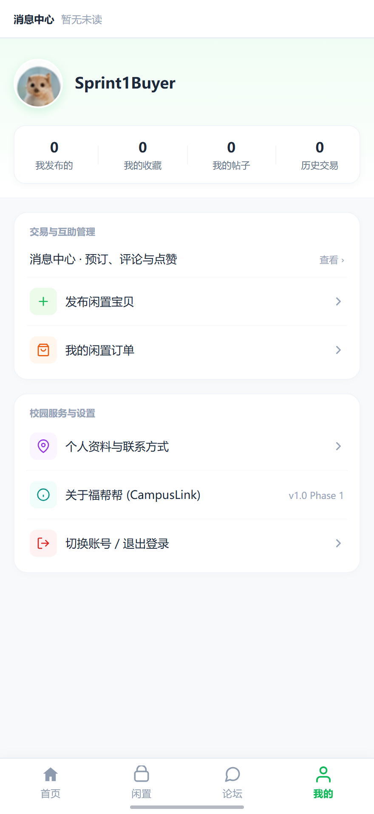

## Figure 3

Real uploaded cover and completed product form before submission.

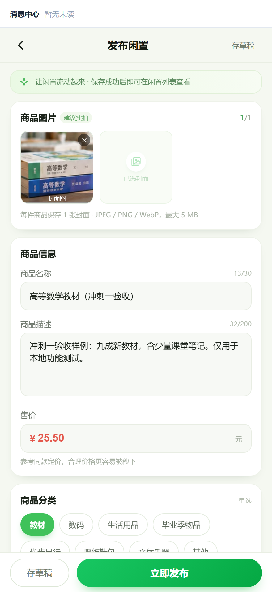

## Figure 4

Published product after a page refresh and a real logout and login.

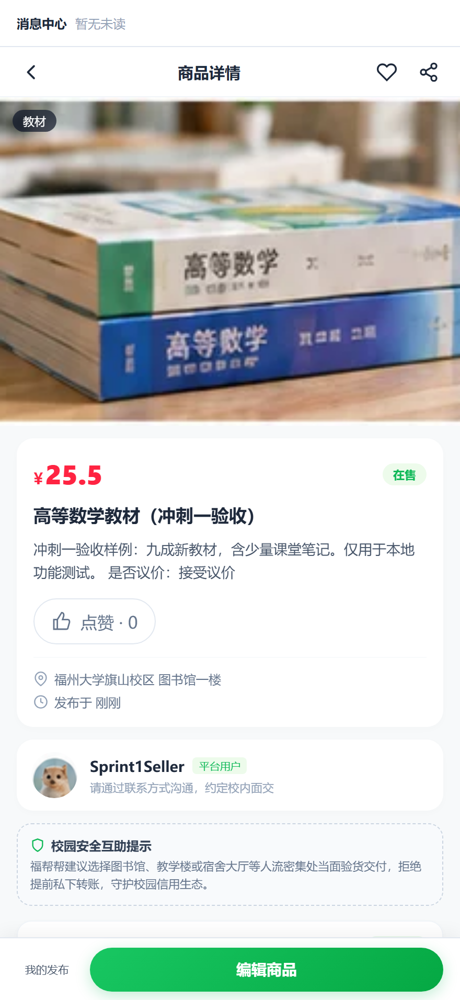

## Figure 5

Buyer finds the seller product through the marketplace search.

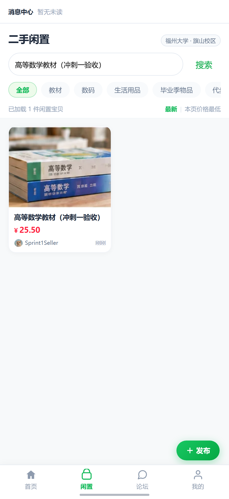

## Figure 6

Buyer sees the seller updated price of CNY 19.80.

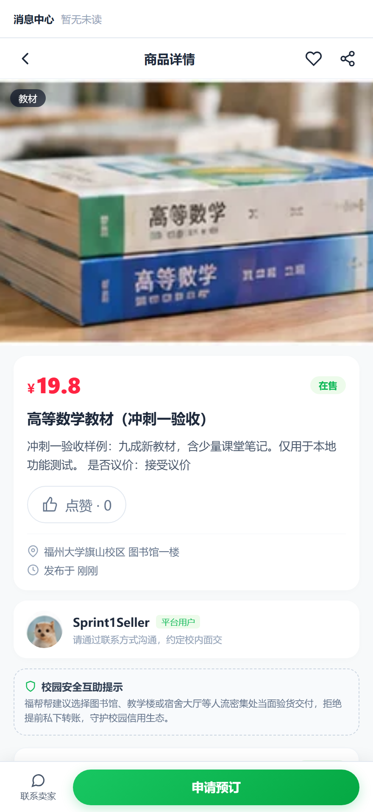

## Figure 7

Buyer opens the seller contact dialog with test contact details.

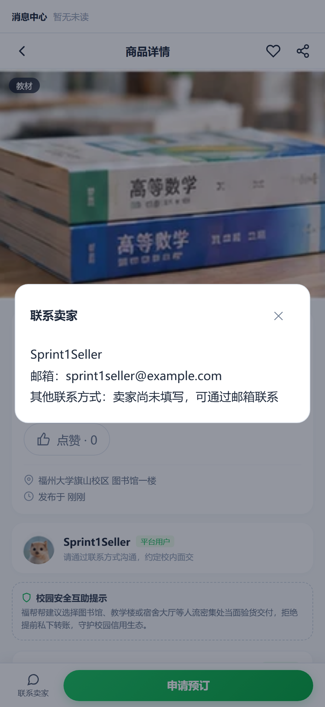

## Figure 8

Buyer transaction request is pending seller action.

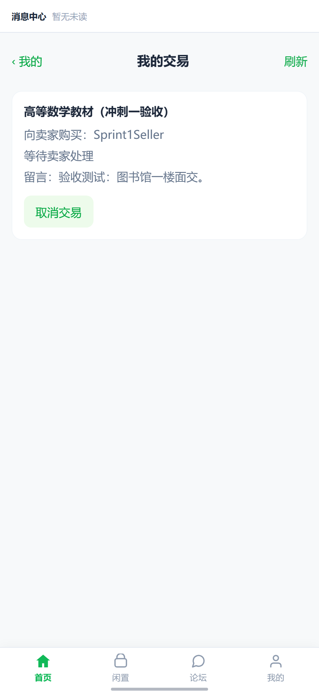

## Figure 9

Seller accepted the request and the product is reserved.

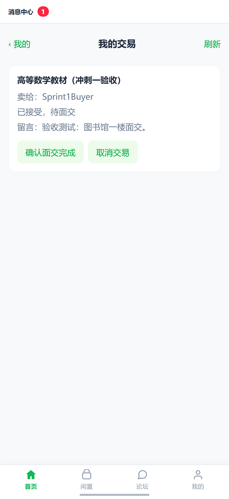

## Figure 10

Seller transaction record after confirming completion in the test scenario.

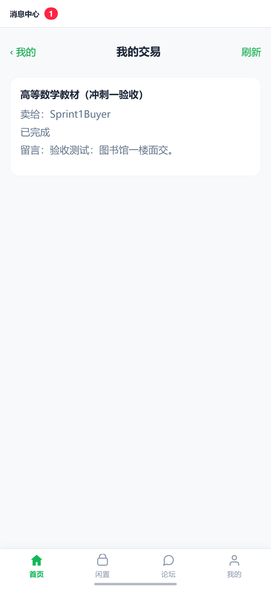

## Figure 11

Buyer sees the completed transaction after refresh.

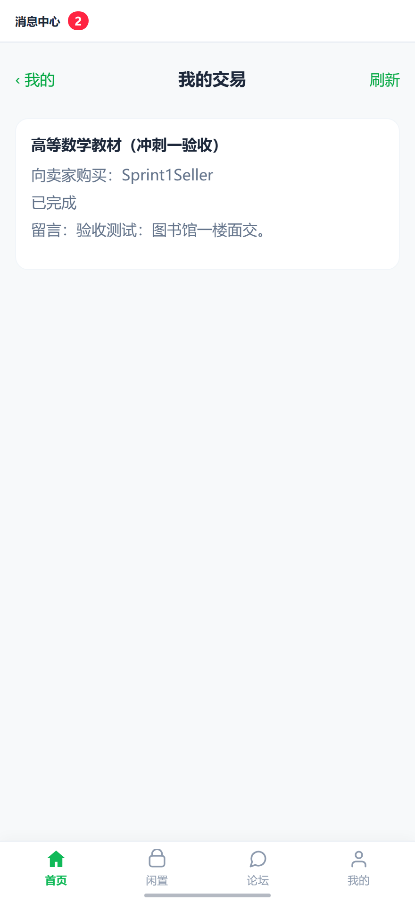

## Figure 12

Product status is sold and a new booking is disabled.

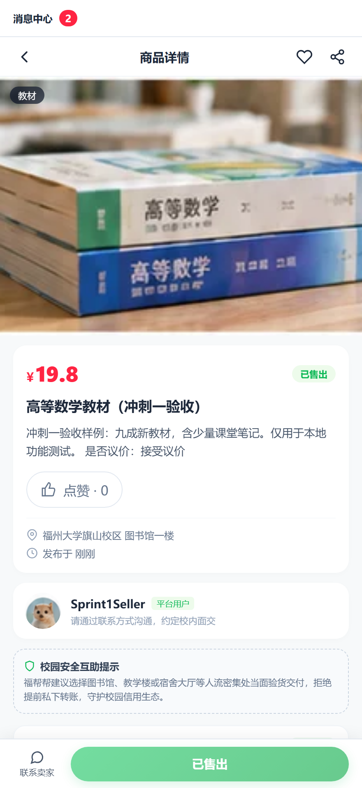

## Figure 13

Forum post and content remain available after refreshing the page.

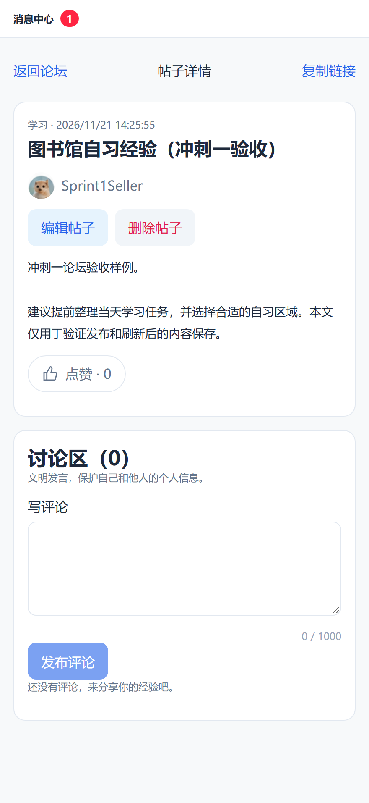

## Figure 14

Incorrect password produces an error and no authenticated session.

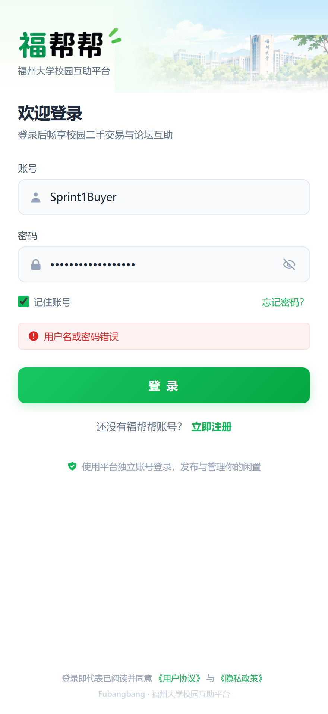

## Figure 15

The product title field retains 30 of 31 typed ASCII characters and displays the 30-character counter.

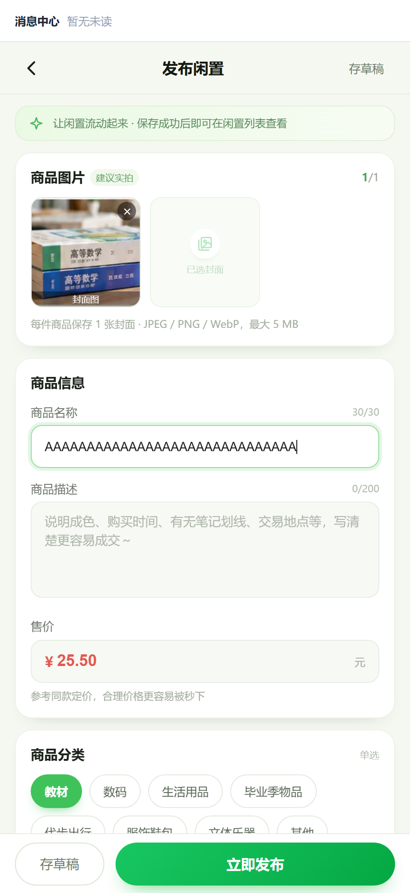

## Figure 16

The publishing form blocks a whitespace-only title before sending a product creation request.

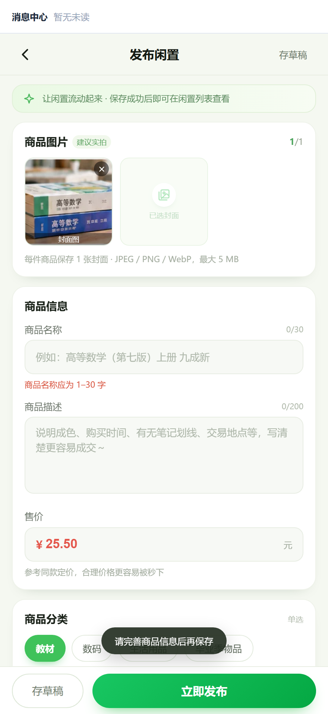

[Boundary check record](TITLE-BOUNDARY-CHECKS.md)
