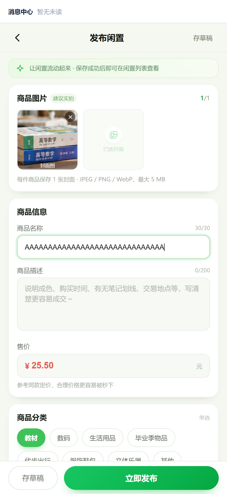
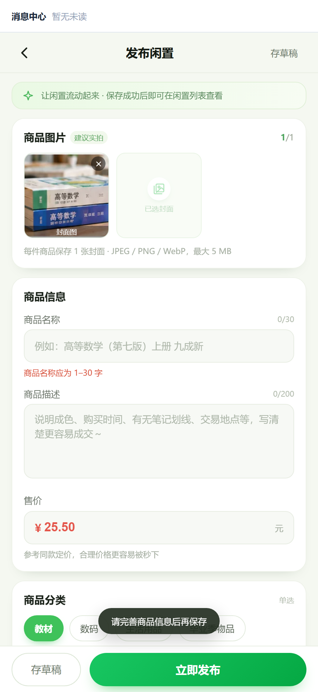

# Fubangbang Sprint 1 Product Title Boundary Checks

**Executed:** November 21, 2026  
**Purpose:** Reproduce and classify existing behavior before a fix

Seventeen API observations and two browser checks were completed against a separate local SQLite database. These are pre-fix observations. They do not indicate that the proposed unified validation rule has passed.

## API observations

| Input | Create response | Update response | Observed storage or behavior |
| --- | --- | --- | --- |
| One ASCII character | HTTP 201 | HTTP 200 | Accepted by both operations |
| 30 ASCII characters | HTTP 201 | HTTP 200 | Accepted by both operations |
| 31 ASCII characters | HTTP 201 | HTTP 200 | Saved in full by both operations despite the UI limit of 30 |
| 120 ASCII characters | HTTP 201 | HTTP 200 | Saved in full by both operations |
| 121 ASCII characters | HTTP 422 | HTTP 422 | Both operations rejected the input; the update target retained its original title |
| Empty string | HTTP 422 | HTTP 422 | Both operations rejected the input |
| Three spaces | HTTP 422 | HTTP 200 | Create rejected the input; update stored three spaces |
| Surrounding spaces around Valid title | HTTP 201 | HTTP 200 | Create stored the trimmed title; update retained the surrounding spaces |
| Title omitted in a price-only update | Not applicable | HTTP 200 | Price changed to CNY 19.80 and the original title was preserved |

The checks used authenticated requests to `POST /api/products` and `PUT /api/products/{id}`. Each update case started with its own valid product. Stored values were read back through the product API. Requests did not use the normal development database.

## Browser observations

### Title input limit

Typing 31 ASCII characters into the product title field retained 30 characters. The actual input element had `maxLength` set to 30. The screenshot shows the resulting counter and field value.

### Whitespace title submission

With a cover, valid price, and category supplied, a whitespace-only title produced the form validation message. The browser stayed on the publishing page, and no product creation request was sent.

The PNG files are unmodified screenshots of the running application at 880 by 1912 pixels. The existing Chinese interface is retained. Browser actions were automated.

## Findings and scope

S1-01 records the UI and API length mismatch. S1-02 records the difference in title trimming and blank validation between creation and updating. The screenshots establish the UI behavior; the API results establish the backend behavior. The latter is not inferred from screenshots alone.

The supplied fields were controlled for these checks. Explicit null values, supplementary Unicode characters, concurrent updates, and other product fields were not investigated here.

- [Issue review and priorities](04-issue-review.md)
- [Raw request and response observations](evidence/title-boundary-results.json)
- [Execution output](evidence/title-boundary-execution.txt)
- [Sprint 2 task plan](SPRINT2-TASK-PLAN.md)
