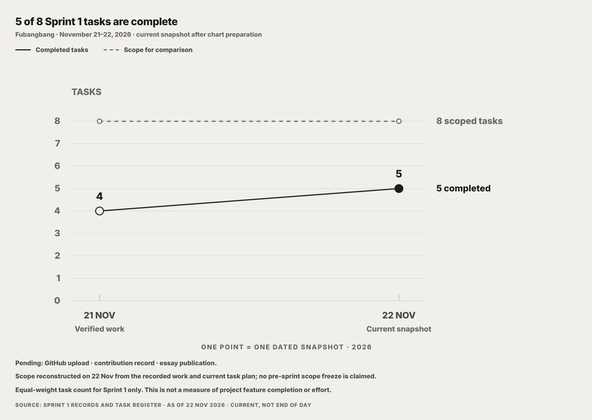

# Fubangbang Sprint 1 Burn-Up Chart

**Period:** November 21–22, 2026  
**Snapshot:** November 22, after chart preparation; this is not an end-of-day report  
**Unit:** Tasks, with one equal-weight unit per task  
**Current result:** 5 completed / 8 scoped tasks

## What the chart shows

A burn-up chart plots cumulative completed work over time alongside the total work in scope. The two lines meet when all scoped work is complete. See [Atlassian's explanation of burn-up charts](https://www.atlassian.com/agile/project-management/burn-up-chart).

The solid line is completed Sprint 1 tasks. The dashed line is the eight-task scope used for comparison. This chart describes the current two-day sprint task list. It does not measure full-project feature completion, hours, effort, or story points. Features that existed before this sprint are not counted as new work.

## Scope and dated evidence

The eight-task list was reconstructed on November 22 from four work packages documented on November 21 and the four November 22 tasks specified in the current plan. The horizontal scope reference applies this reconstructed list to both snapshots for comparison. It is not evidence that eight tasks were formally committed before the sprint began, or that scope did not change historically.

| Dated snapshot | Completed tasks | Comparison scope | Basis |
| --- | ---: | ---: | --- |
| November 21 | 4 | 8 | Existing environment, checks, acceptance, and issue-review records |
| November 22, current | 5 | 8 | The same four work packages plus this prepared and verified chart |

Only these two dated snapshots are available. No starting-zero point, intermediate progress, or future completion has been invented. This is a Sprint 1 view; a later whole-Alpha chart should use a confirmed cross-sprint task list and consistent units.

## Task register

| ID | Task | Status | Completion date | Evidence or completion condition |
| --- | --- | --- | --- | --- |
| S1-T01 | Environment reproduction and source baseline | Done | November 21 | Step 1 record |
| S1-T02 | Initial automated checks and result record | Done | November 21 | Step 2 record |
| S1-T03 | Two-account browser acceptance and screenshots | Done | November 21 | Step 3 record |
| S1-T04 | Issue investigation and next-sprint plan | Done | November 21 | Step 4, title boundary checks, and Sprint 2 plan |
| S1-T05 | Prepare and verify the burn-up chart | Done | November 22 | This image, offline HTML, and task dataset |
| S1-T06 | Upload source and sprint evidence to GitHub | Pending | — | Actual upload and accessible commit/repository link |
| S1-T07 | Complete the contribution record | Pending | — | Actual member work details and completed record |
| S1-T08 | Finalize and publish the Sprint 1 essay | Pending | — | Final essay and publication link; the existing draft alone is insufficient |

The underlying four verification records are in the parent sprint directory when this chart is placed in the organized archive. The source and captured runtime images have not been changed. The title-validation issues remain open; completing investigation does not mean fixing them.

## Files and reuse

- `burn-up-current.png`: English image for the sprint essay, including scope and status notes.
- `burn-up-current.html`: Standalone offline chart with its font and dataset embedded.
- `burn-up-data.json`: Task register, snapshot values, scope basis, and dates.
- `burn-up-plot.svg`: Plot-only vector companion. Use it with this document's caption and scope notes; the PNG already includes them.

Suggested essay caption: **Sprint 1 task burn-up, current snapshot on November 22, 2026. Four evidenced work packages were completed on November 21; chart preparation brings the current count to five out of eight tasks. GitHub upload, the contribution record, and essay publication remain pending. The comparison scope was reconstructed on November 22.**

## Updating the chart

Mark each remaining task complete only after its completion condition is met, record its actual completion date and evidence, and recalculate the cumulative count. Replace the current November 22 snapshot with the final same-day snapshot when closing the sprint, while retaining a copy of this interim version. Regenerate both the HTML and image so their embedded values agree with the dataset; editing the JSON alone does not update the existing picture or HTML.

If all three remaining tasks are actually completed on November 22 and scope remains unchanged, the final count will be 8/8. That value is not claimed in this version. If tasks are added or removed, record the scope change explicitly instead of silently changing the comparison line. Use the same task granularity across later charts.
