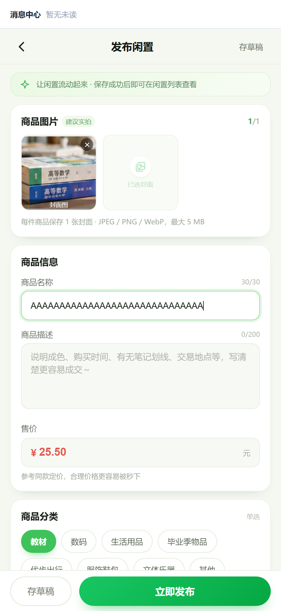
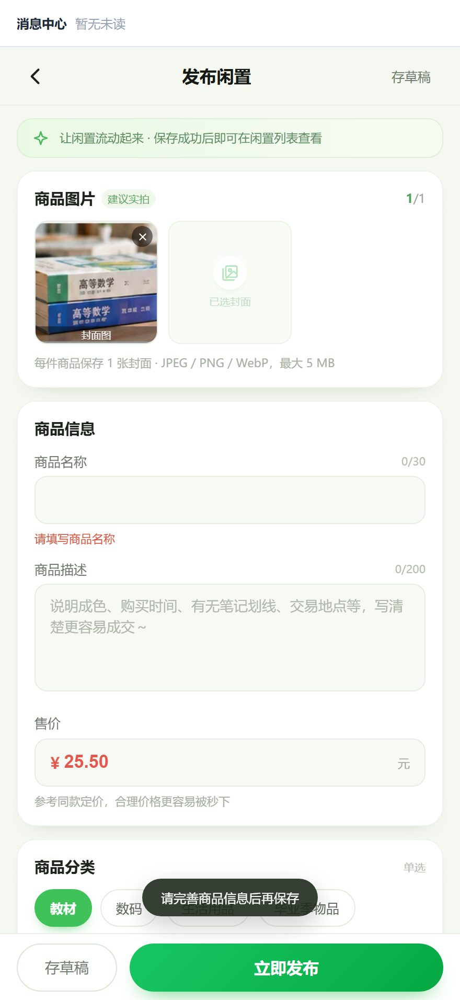
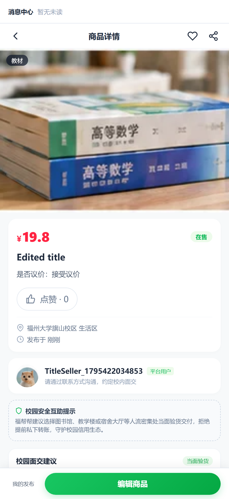
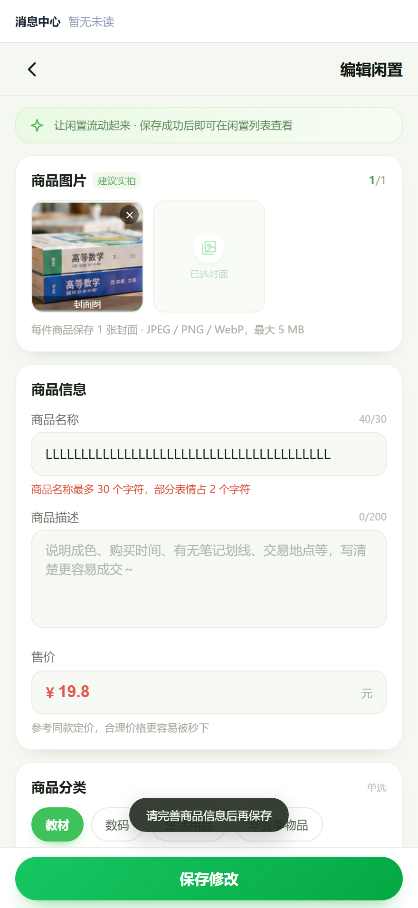

# Sprint 2 Runtime Screenshots

Five original browser captures, 880 × 1912 pixels each.

## 1. 01-title-limit-30.png

The browser retains 30 of 31 typed ASCII characters and displays 30/30.

## 2. 02-blank-title-rejected.png

A blank title produces a field error without sending a product request.

## 3. 03-normalized-published-title.png

Published title is trimmed and remains visible after refresh.

## 4. 04-edited-title-after-new-login.png

After a new login, editing stores the normalized title and new price.

## 5. 05-legacy-title-requires-correction.png

An existing 40-unit title is preserved and flagged for correction; submission is blocked.

