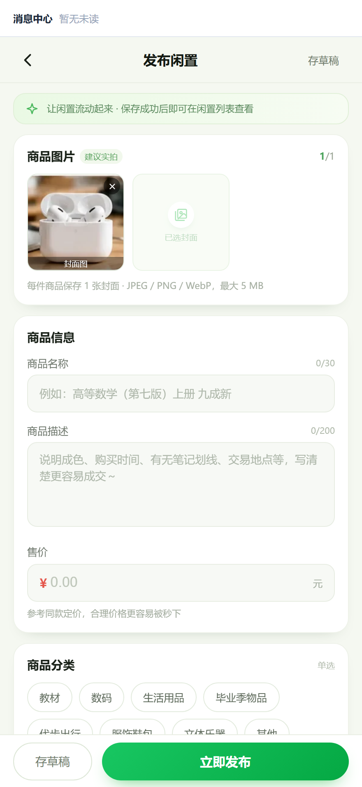
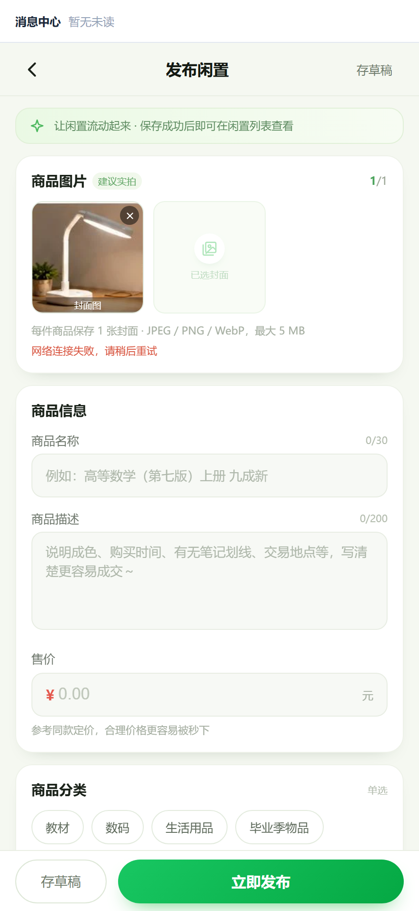
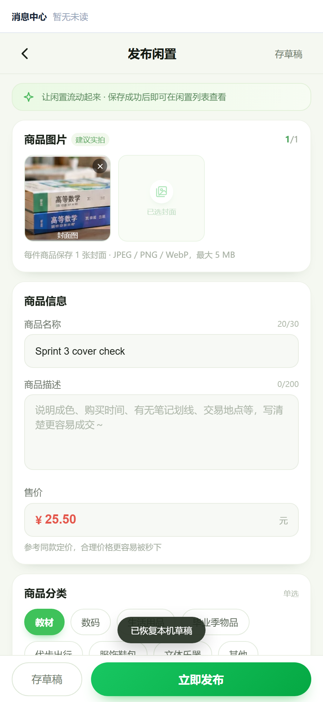
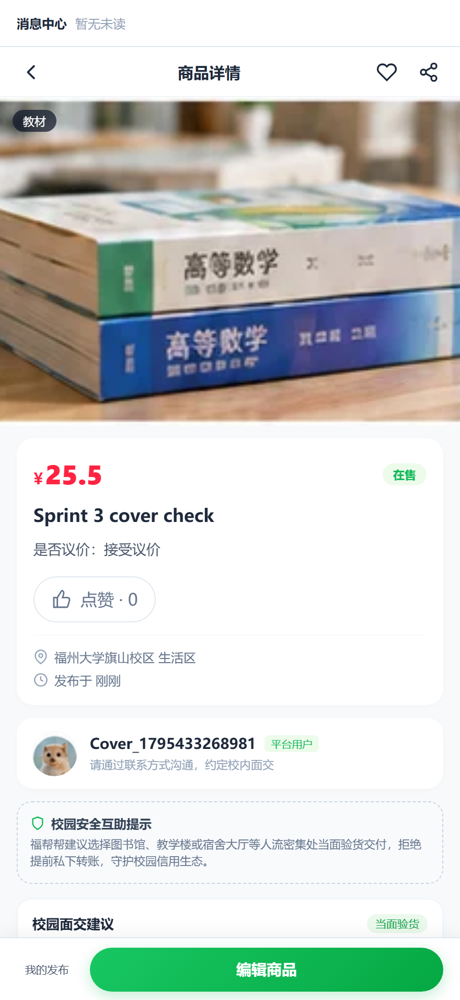
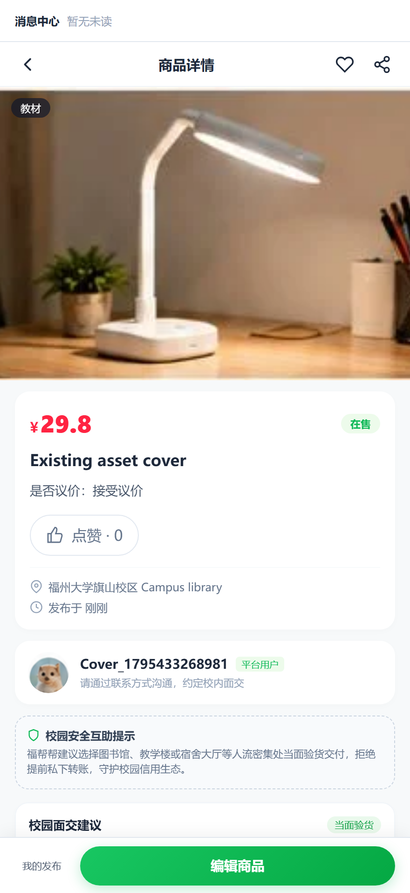

# Sprint 3 Runtime Screenshots

Seven original Edge captures, 880 × 1912 pixels each. Captured November 23, 2026, using disposable local test data.

## Figure 1

A valid image is uploaded through the API and displayed as the single product cover.

## Figure 2

An unsupported file displays the format and size message while retaining the existing cover.

## Figure 3

A deliberately interrupted upload shows a network error and retains the previous cover.

## Figure 4

Selecting the same file again succeeds, displays its new cover and clears the upload error.

## Figure 5

Reloading the publishing page restores the saved title, price and uploaded cover from the local draft.

## Figure 6

The published product remains available with the selected uploaded cover after refreshing its detail page.

## Figure 7

An owner replaces the cover and saves the edit; the refreshed product displays the persisted replacement and updated price.

