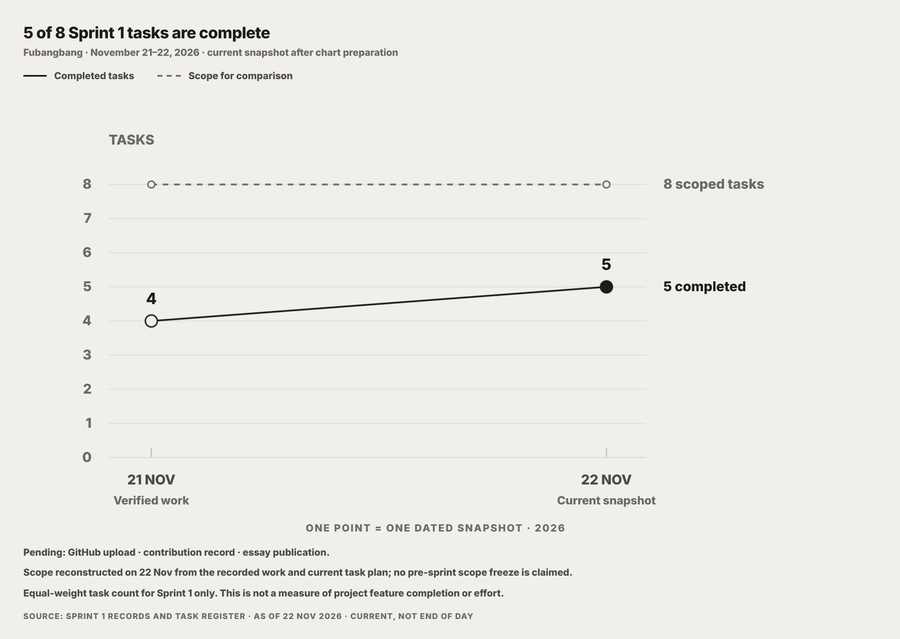

# Fubangbang Alpha Sprint 1 Environment Reproduction and Baseline Verification

**Status:** Draft based on November 21 verification records and a November 22 interim burn-up snapshot  
**Sprint period:** November 21–22, 2026

Before publication, update the chart after remaining work is completed, add the actual November 22 closing review, deferred member work information, and the final repository links. This draft records the results currently available in the archive.

| Item | Description |
| --- | --- |
| Course | EE308FZ Software Engineering |
| Assignment | [Fifth Assignment Alpha Sprint](https://bbs.csdn.net/topics/620611106) |
| Team | Fubangbang |
| Sprint objective | Reproduce the existing handoff version, verify its core flows, and identify focused improvements for the next sprint |
| References | Existing project source, handoff documents, automated test scripts, and execution evidence |

## Sprint objective and starting point

Fubangbang already had a Vue frontend, a FastAPI backend, and implementations of account, marketplace, transaction, and forum functions before this sprint. The first sprint focuses on establishing a reproducible local baseline and checking the existing behavior. The following validation fixes are planned for later implementation.

The current work covers environment reproduction, execution of existing automated checks, a focused two-account acceptance run, and investigation of product title boundaries. The [record index](../docs/sprints/sprint-1/README.md) links to each detailed result.

## Environment reproduction

The handoff version was started on a Windows machine using Node.js v24.19.0, npm 11.17.0, and Python 3.13.12. The local environment used SQLite. The frontend returned HTTP 200, and the backend health endpoint confirmed database connectivity.

A manifest recorded 263 original handoff files. Their hashes remained unchanged during verification. The [environment record](../docs/sprints/sprint-1/01-environment-and-baseline.md) explains the commands, environment, and startup evidence.

## Initial automated checks

| Check | Recorded outcome |
| --- | --- |
| Frontend type check | Passed |
| Frontend build | Passed |
| Existing backend tests | 57 passed, 3 skipped, 0 failed |
| Existing browser automation | Completed successfully |

The three skipped backend cases require PostgreSQL and remain unverified in this local run. One test-client deprecation warning was recorded for future dependency maintenance. Complete standalone logs for the original frontend type check and build were not retained; their outcomes were recorded from the command execution results.

The [automated check record](../docs/sprints/sprint-1/02-initial-automated-checks.md) and its evidence provide the detailed scope.

## Focused acceptance with two accounts

Separate seller and buyer sessions exercised the real application with an isolated local database. Browser actions were automated, and screenshots were captured from the rendered pages. Ten focused checks passed, covering registration and login, product publication and retrieval, buyer search, price editing, ownership permissions, seller contact details, transaction state changes, forum publication, and incorrect-password handling.

The product remained available after refresh and a new login. The buyer found it through search and saw the price change from CNY 25.50 to CNY 19.80. An authenticated edit attempt from the buyer account returned HTTP 403. The transaction progressed through pending, accepted, and completed states, and the product was marked sold in the local test scenario.

A forum post remained available after refresh and could be opened by the other account. An incorrect password produced an error without creating an authenticated session. The [acceptance record](../docs/sprints/sprint-1/03-browser-acceptance.md) and [screenshot gallery](../docs/sprints/sprint-1/SCREENSHOTS.md) contain the complete evidence.

## Boundary findings and priorities

Focused investigation added 17 API observations and two UI checks. It identified behavior outside the normal paths exercised above.

| Finding | Observed behavior | Treatment |
| --- | --- | --- |
| Product title length differs by entry point | The UI retained at most 30 typed ASCII characters, while create and update APIs saved 31-character and 120-character titles | Confirm and implement one rule in Sprint 2 |
| Product updates skip equivalent blank validation and trimming | Creation rejected a whitespace-only title, but updating stored it; updating also retained surrounding spaces | Share title validation between creation and updating in Sprint 2 |
| Publishing responsibilities are concentrated in one view | Upload, draft storage, edit loading, validation, and submission share the publishing view script | Plan one limited extraction for Sprint 3 |

The [issue review](../docs/sprints/sprint-1/04-issue-review.md) records the reproduction steps, impact, evidence, and priorities. These issues remain open. The publishing-view item is a maintenance improvement rather than a demonstrated failure of the publish flow.

## Burn up chart

The current count is 5 completed tasks out of 8: four evidenced verification work packages from November 21, plus chart preparation on November 22. GitHub upload, the contribution record, and essay publication remain pending.

The eight-task comparison scope was reconstructed on November 22 from the existing records and the current task plan; no pre-sprint scope freeze is claimed. Each task has equal weight. This measures Sprint 1 task completion rather than full-project feature progress or effort. It is an interim snapshot, not the November 22 closing result. The [task register and scope notes](../docs/sprints/sprint-1/charts/BURN-UP-CHART.md) explain the dataset and subsequent updates.

## Next sprint plan

Sprint 2 is planned for November 23–24. It will confirm the product title contract, implement consistent validation for creation and editing, add boundary regression tests, and repeat the affected browser flow. A price-only update must continue to preserve the existing title.

The [Sprint 2 task plan](../docs/sprints/sprint-1/SPRINT2-TASK-PLAN.md) defines the proposed rules, work estimates, and completion criteria. No implementation results or future pass counts are claimed in this draft.

## Current review

The November 21 checks established that the recorded core flows run locally and exposed two title-validation inconsistencies through focused inputs. They provide a concrete starting point for a small corrective change in the next sprint. Add the actual November 22 review before publishing the final two-day essay.
